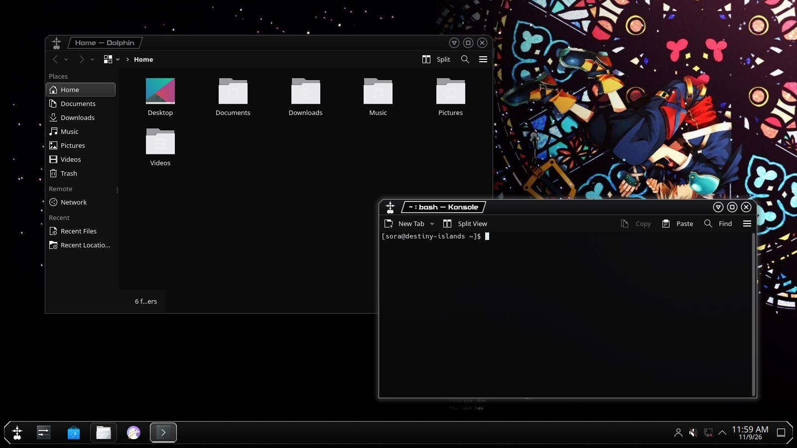
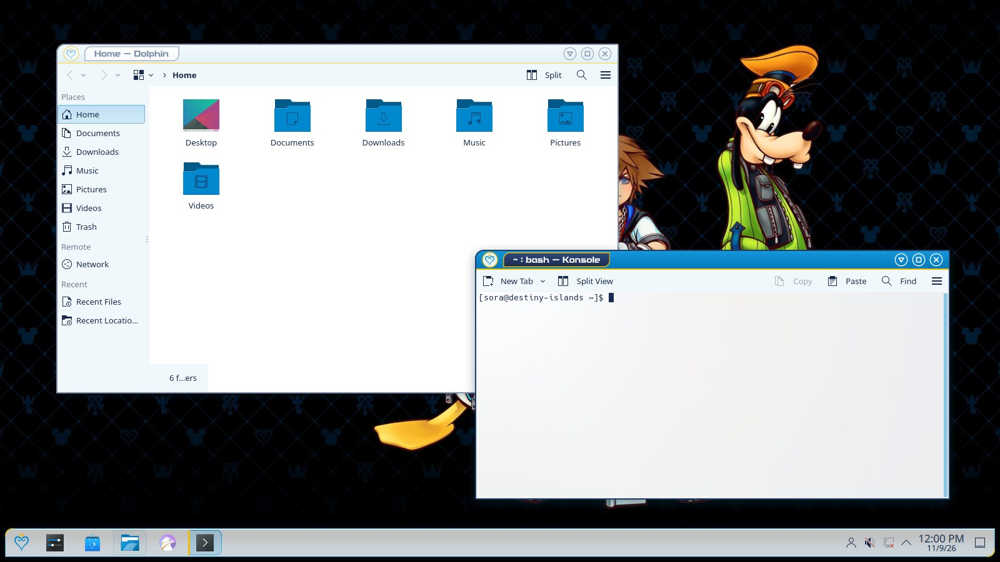
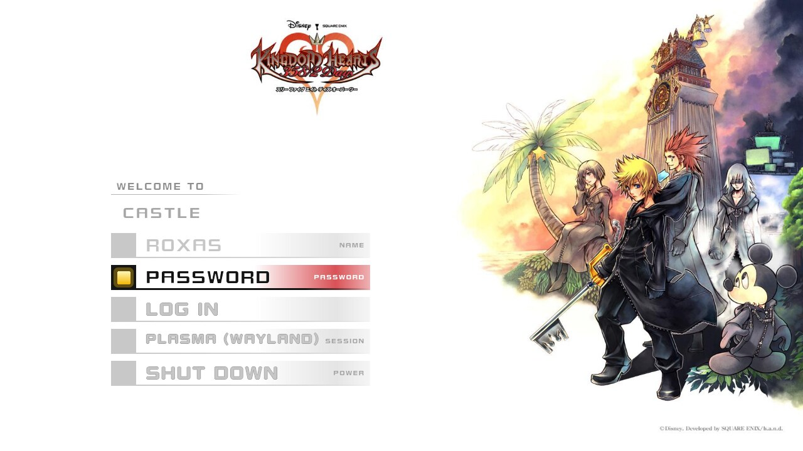
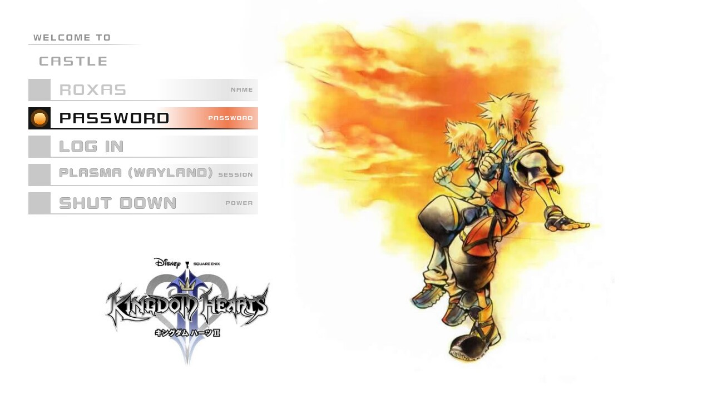
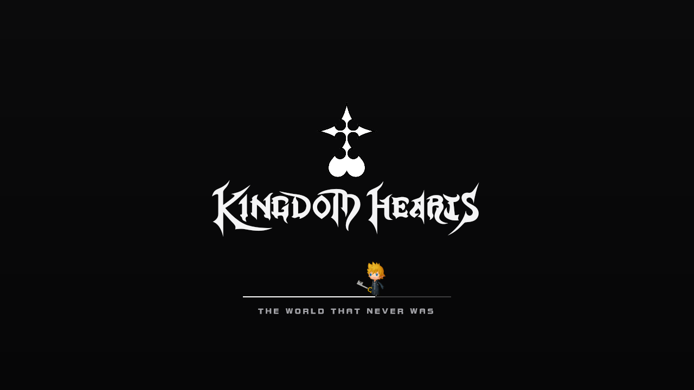
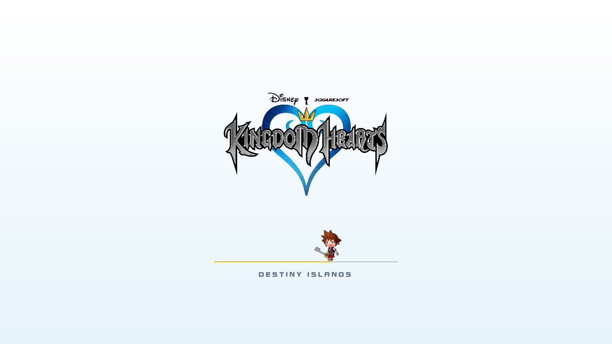
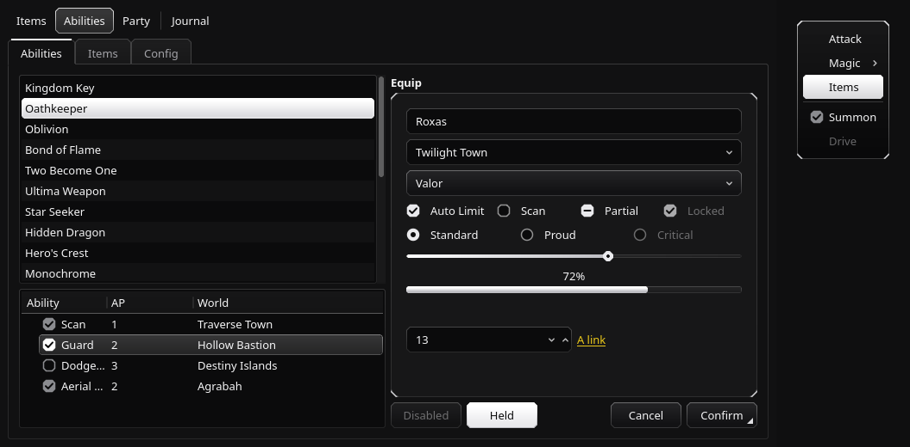
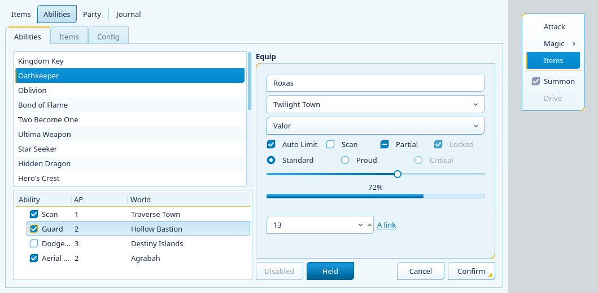
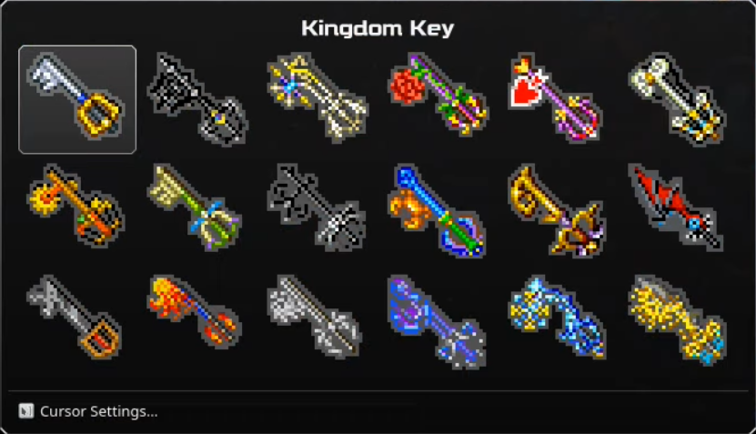

# Kingdom Hearts for KDE Plasma

A complete theme for KDE Plasma 6 in two variants that share one palette
vocabulary, taken from the series' own art:

| Variant | Mode | Look |
| --- | --- | --- |
| **Organization XIII** (`OrgXIII`) | dark | Black with white accents, after the black command menu of the second game: clipped corners, white hairlines, white selection bars with black text. Kingdom Key D gold appears only on links. |
| **Sora** (`Sora`) | light | The first game's colours: logo blue title bars and selection, crown gold rules and ornaments, navy text, frames shaped like that game's menu headings (one rounded corner, one square). |

Colours come from the reference art, not from taste: the logo's heart blue
`#0088ce` and crown gold `#efbb05`, the Kingdom Key D's gold `#ebc81a` and
silver `#c8cbcb`, and the five colours of the first game's command menu for
errors, warnings, success, links and information.

This is a fan project, not affiliated with or endorsed by Disney or Square
Enix. The artwork, logos, sprites and sounds under `assets/` are theirs (or
their fan authors'); see `ASSETS.md` for every source. Keep it to personal use.

## Screenshots

| | Organization XIII | Sora |
| --- | --- | --- |
| Desktop |  |  |
| Login screen |  |  |
| Splash screen |  |  |
| Applications |  |  |

The keyblade browser: Super + right click on the desktop, and the keyblade you
pick becomes the mouse pointer.



## What you get

For each variant:

- **Global Theme** tying everything together, with a **splash screen** laid out
  like a title screen: the logo or sigil, and the variant's sprite walking a
  line as startup progresses
- **Window decoration**: the caption sits in a command-menu header plate, the
  buttons are round controller prompts (triangle to minimise, square to
  maximise, cross to close), the window-menu button is the emblem. Buttons
  whose action cannot apply to a window (context help in an application that
  offers none, "on all desktops" with a single desktop) are left out
- **Plasma Style**: panel, popups, notifications, tooltips, task buttons and
  list highlights in the same shapes as the windows
- **Colour scheme** for applications
- **Application style** (Kvantum): buttons, fields, tabs, lists, menus, scroll
  bars and sliders in the same shapes. Organization XIII selects with the white
  bar and black text of the second game's command menu; Sora with logo blue
  and the gold bar down the left of the first game's menus
- **Cursor theme**: the Kingdom Key sprite from *Chain of Memories* as
  pointer, the menu glove on links, a walking Sora or Roxas while busy. The
  pointer can be any of the game's 18 keyblades (see *Keyblades* below)
- **Icon theme**: heart-and-crown or Nobody sigil as the application launcher,
  on top of Breeze
- **Wallpapers**: four to six pictures per variant
- **Konsole colour scheme**

Shared by both: a wallpaper package that swaps its picture with the colour
scheme, a **sound theme** in which each event plays the game sound with the
same meaning, the menu and title **fonts**, and an **SDDM login theme**.

## Requirements

- KDE Plasma 6 (KWin with the Aurorae decoration engine)
- Kvantum (the `kvantum` package) for the application style; without it `apply`
  falls back to Breeze in the theme's colours
- Python 3.10+
- Build tools: `rsvg-convert` (librsvg), `magick` (ImageMagick 7), `ffmpeg`
- For the keyblade menu: `cmake` and a C++20 compiler, with the Qt 6, KDE
  Frameworks (KConfig, KCoreAddons) and Plasma (libplasma) development files.
  On Arch Linux these come with the regular packages
- PyQt6 with Qt Quick (`python-pyqt6`, `qt6-declarative`) to draw the login screens'
  preview for System Settings, and for `tools/preview.py`

## Installing from the AUR

On Arch Linux the package builds everything on your machine and installs it
system-wide: the themes under `/usr/share`, the keyblade menu in Qt's plugin
folder.

```sh
yay -S kingdom-hearts-plasma
kingdom-hearts-plasma apply Sora      # or OrgXIII; each user runs this
```

`kingdom-hearts-plasma` takes the same commands as `./install.py` below
(`apply`, `revert`, `status`, `keyblade`, `sddm`, `span`, `uninstall`); there is
nothing to `install`. The system copies of the cursor themes are read-only, so
the first time you choose a keyblade they are copied to `~/.icons` and the copy
is changed; after a package upgrade the next `apply` or keyblade choice makes
the copy again. Before removing the package, run `kingdom-hearts-plasma revert`
and then `kingdom-hearts-plasma uninstall`, which deletes those copies.

### After Plasma updates

The keyblade menu is the one compiled part. It uses only public Qt, KDE
Frameworks and libplasma API, so a build keeps working across Qt and Frameworks
updates, whose libraries stay `.so.6` for all of 6.x. libplasma is the
exception: it raises its library version when its ABI changes, and a build made
before that cannot load. The rest of the theme is unaffected, and `apply` and
`status` report it with the command that fixes it: `yay -S --rebuild
kingdom-hearts-plasma`, or from source `./build.py --only picker && ./install.py
install`. `checkrebuild` (package `rebuild-detector`) lists it as well.

## Installing from source

Take the source bundle (`kingdom-hearts-plasma-<version>.tar.gz`) from the
project's releases page, or clone the repository, then:

```sh
./build.py                    # generate everything into dist/
./install.py install          # copy into ~/.local/share
./install.py apply OrgXIII    # or: ./install.py apply Sora
```

To go back to the desktop you had before:

```sh
./install.py revert
```

`apply` records your current look first (theme ids, accent colour, sound
theme, wallpaper plugin, lock-screen wallpaper, plus copies of the touched
config files) in `~/.local/state/kingdom-hearts-plasma/`, and `revert` restores
from that record. If you change the desktop by hand between two `apply` runs,
the record is refreshed, so `revert` returns to what you last had. A custom
accent colour is removed while a variant is active, because it would override
the variant's selection colours; `revert` puts it back.

Other commands:

```sh
./install.py status                 # what is installed and what is active (JSON)
./install.py apply Sora --konsole   # also recolour Konsole profiles
./install.py uninstall              # remove installed files (revert first)
```

### Light/dark switching

`apply` registers Sora as the light Global Theme and Organization XIII as the
dark one, so Plasma's own day/night switch (System Settings → Colors & Themes →
Global Theme) moves between the two. The wallpaper, lock screen and
application style follow: the light theme selects the `kvantum` style and the
dark one `kvantum-dark`, and the one Kvantum theme, `KingdomHearts`, holds both
variants.

### Choosing parts by hand

Every part is also listed on its own under System Settings → Colors & Themes,
named "Kingdom Hearts — Organization XIII" or "Kingdom Hearts — Sora": Colors,
Plasma Style, Window Decorations, Icons, Cursors, System Sounds, Splash Screen,
and the wallpaper. Cursor themes are installed in `~/.icons`, the folder that
page lists. The application style is chosen under Application Style
(`kvantum` for Sora, `kvantum-dark` for Organization XIII); the Kvantum theme
itself lives in `~/.config/Kvantum/KingdomHearts`, and Kvantum Manager can
select or edit it. Edited copies it saves as `KingdomHearts#` are left alone by
`install` and `uninstall`.

### Wallpapers

All pictures appear in the wallpaper chooser as "Kingdom Hearts — …". The
package named plain "Kingdom Hearts" is the one `apply` sets: it shows Sora,
Donald and Goofy in light mode and the Dive to the Heart picture in dark mode.
The picture each variant starts with is the entry marked `default=True` in
`khtheme/wallpapers.py`.

#### Across several screens

With two or more screens, `apply` spreads one picture over all of them, as if
it were a single wallpaper behind the whole arrangement. The screens' places
come from the desktop's own layout (Display Configuration), so rotation,
offsets and scale are taken into account: a portrait screen beside a landscape
one shows the part of the picture that lies behind it, and the area no screen
covers is left out. Each screen's part keeps a light and a dark picture, so the
day/night switch still works. The parts are written to
`~/.local/share/kingdom-hearts-plasma/span/` and the screens show them as
ordinary wallpaper packages.

The span follows the desktop. When a screen is attached, removed or moved, or
when you choose another "Kingdom Hearts — …" picture for any screen, the sync
unit (below) cuts the picture again. If you choose a picture of your own for a
screen, the span stops and your choice is left alone. By hand:

```sh
./install.py span                 # spread what the desktop shows
./install.py span ~/Pictures/x.jpg  # spread any picture or wallpaper package
./install.py span off             # stop; every screen shows the whole picture
```

With one screen the picture is shown whole. Spanning needs ImageMagick
(`magick`).

### Sounds

System Settings → Colors & Themes → System Sounds shows the theme as "Kingdom
Hearts". Every event plays the effect that serves the same purpose in the
games:

| On the desktop | In the games |
| --- | --- |
| A notification or information box | the information pop-up |
| Changing the volume, cycling completions | the cursor stepping to another entry |
| Pressing, confirming, a device connecting | confirming an entry |
| Cancelling, closing, a device leaving | backing out of a menu |
| A question or password prompt | a menu opening |
| The system bell, an error | the "not allowed" sound |
| Battery low | the low-health alarm |
| Battery full | a gauge reaching its maximum |
| Saving or burning finished | the game being saved |
| Timer ran out | a match countdown ending |
| Logging in / out | starting from the title screen / a computer shutting down |
| Screenshot or photo | taking a picture |
| Emptying the trash | a defeated enemy disappearing |

The full list is the `EVENTS` table in `khtheme/sounds.py`. Plasma itself has no
event for hovering or clicking ordinary menu entries, so the cursor and confirm
sounds are heard where the desktop does raise an event (volume steps, text
completion) and in applications that play input-feedback sounds from the theme.

### Keyblades

The pointer can be any of the 18 keyblades of *Chain of Memories*. Hold
<kbd>Super</kbd> and right-click an empty spot of the desktop: a menu shows
them all, names the one under the mouse, and marks the one in use. Click one
and it becomes the pointer, in both variants. The pointer shows the Breeze
cursor for about a second while the window manager reloads it. Applications
that draw their own cursor (some X11 and GTK programs) show the new keyblade
once they are restarted. "Cursor Settings…" in the same menu opens the cursor
page of System Settings.

From a terminal:

```sh
./install.py keyblade             # list the keyblades (JSON)
./install.py keyblade oathkeeper  # point with one
```

The choice is kept in `~/.config/kingdom-hearts-plasmarc`, and `install`
puts it back after replacing the cursor themes.

To make <kbd>Super</kbd> + right-click reach the desktop, `apply` changes
what KWin does with it. KWin's default for <kbd>Super</kbd> + right-drag is
resizing a window, and it keeps the click from the desktop. While a variant is
applied, that combination activates the window under the mouse and passes the
click on instead, so **Super + right-drag no longer resizes windows**
(<kbd>Super</kbd> + left-drag still moves them). `revert` restores KWin's
setting. To use another button for the menu, pick "Keyblade Browser" for it
under Desktop and Wallpaper → Mouse Actions (right-click the desktop →
Desktop and Wallpaper). The menu plugin is loaded by the Plasma shell from
`~/.local/share/kingdom-hearts-plasma/plugins`, which a login script in
`~/.config/plasma-workspace/env/` puts on `QT_PLUGIN_PATH`; `apply` restarts
the shell once so the running session finds it. The AUR package puts the plugin
in Qt's own plugin folder instead, where the shell finds it without the script.

Applying a Global Theme together with its desktop layout (Breeze's, or one
of these from System Settings with "Desktop and window layout" ticked) makes
the shell discard its whole configuration and rebuild the default desktop,
mouse actions included. `apply` therefore also adds a drop-in,
`~/.config/systemd/user/plasma-plasmashell.service.d/kingdom-hearts-plasma.conf`,
that runs `install.py rebind` before every shell start: if the binding is gone
it is put back, so it returns at the next login or reboot. A different action
you chose for Super + right click under Mouse Actions is left alone. Until the
shell restarts, `status` reports `"keyblade_browser_bound": false`; run
`apply` again to get it back at once. `revert` and `uninstall` remove the
drop-in.

### Fonts

KHMenu, KHGummi and KHTitle are installed as user fonts. The decoration,
splash and login screen use their own copies; nothing changes your system
fonts. To use KHMenu elsewhere, pick it in System Settings → Fonts.

### Login screen

Each variant is its own SDDM theme, listed in System Settings → Colors &
Themes → Login Screen (SDDM) as "Kingdom Hearts – Organization XIII" and
"Kingdom Hearts – Sora". Pick either there. From then on the login screen
follows the desktop: whenever the Global Theme changes, by `apply` or by
Plasma's day/night switch, the login screen switches to the matching variant.
Pick any other login theme and it is left alone.

SDDM themes live in system directories, so a source install puts them there
once, with root:

```sh
./install.py sddm          # install both themes and the switching helper (sudo)
./install.py sddm Sora     # the same, and select one: OrgXIII | Sora | off
./install.py sddm --print  # show the root commands instead of running them
```

`off` goes back to the login theme used before a Kingdom Hearts one. The AUR
package installs the themes and the helper itself.

The switch is made by a small root helper, `login-screen`
(`/usr/lib/kingdom-hearts-plasma/` from the package,
`/usr/local/lib/kingdom-hearts-plasma/` from source), which the user's sync unit
runs through `pkexec`. Its polkit policy lets any local user run it without a
password because, run that way, it can only switch between the two installed
Kingdom Hearts themes, and only while one of them is already selected. It
writes `[Theme] Current` into the SDDM config file that decides it, usually
`/etc/sddm.conf.d/kde_settings.conf`, the file System Settings writes, so that
page always shows the current choice. The change shows the next time SDDM
starts (log out or reboot).

The sync unit is two user units that `apply` installs and enables,
`~/.config/systemd/user/kingdom-hearts-plasma-sync.{service,path}`. They run
`install.py sync` at login and whenever `kdeglobals` (the Global Theme),
`kwinoutputconfig.json` (the screen layout) or the shell's own file (the
wallpapers) changes. `revert` and `uninstall` remove them. `status` reports
`login_screen`, `login_screen_follows_variant`, `sync_units` and the span.

To remove the login themes and helper of a source install:

```sh
sudo rm -r /usr/share/sddm/themes/KingdomHearts-* /usr/local/lib/kingdom-hearts-plasma \
  /usr/share/polkit-1/actions/org.kingdomhearts.plasma.login-screen.local.policy
```

Select another login theme first; SDDM falls back to its built-in one if the
selected theme is missing.

Each login screen is a title-screen wallpaper with the sign-in drawn as the
games' title menu: a column of bars, each with a square marker, the chosen one
lit (an orange orb for Sora, a gold light for Organization XIII) and its bar
filled with the accent colour. Organization XIII shows the *358/2 Days*
wallpaper with the menu in the middle of the white space on the left; Sora
shows the *Kingdom Hearts II* one with the menu centred in the white space at
the top left. The picture is always shown whole; on a screen of another shape
the white around it continues and the menu stays in the empty part.

The rows are **Name**, **Password**, **Log In**, **Session** and **Power**.
Up and Down (or Tab) move between them, Enter uses one (on the name it moves to
the password; on the password it logs in), and Left and Right change the
session or the power action. A click picks a row; a click on the picked row
uses it, so Shut Down needs two clicks. Above the menu, where a title screen
credits its developer, the computer's name is shown under "Welcome to", which
changes to "Login failed", "Caps Lock is on" or a message from SDDM when there
is one.

The picture in System Settings' Login Screen page is the real screen: the
build draws it off screen with PyQt6 (falling back to the bare wallpaper when
PyQt6 is missing, with a warning).

### Terminal

The Konsole colour schemes are installed but not activated unless you pass
`--konsole` to `apply`. To pick one by hand: Konsole → Settings → Edit Current
Profile → Appearance.

## Customising

Every colour is a named token in `khtheme/palette.py`, one `Palette` per
variant, built from the reference colours at the top of that file. The same
file names the art each variant uses:

| Token | Meaning |
| --- | --- |
| `pointer_rim` | outline drawn round the keyblade pointer so it reads on the variant's surfaces |
| `launcher_art` | emblem for the launcher, window menu and login screen |
| `loading_art` | animated sprite for busy cursors and the splash (`assets/loading/`) |
| `corner` | frame shapes: `cut` (clipped) or `heading` (rounded on opposite corners) |

Wallpapers are listed in `khtheme/wallpapers.py`; add a 16:9 JPEG to
`assets/wallpapers/` and a line to `WALLPAPERS`.

After any change:

```sh
./build.py && ./install.py install && ./install.py apply OrgXIII
```

Useful build options:

```sh
./build.py --only plasmastyle decoration   # rebuild selected components
./build.py --variant Sora                  # one variant only
./build.py --clean                         # start from an empty dist/
```

## Looking before applying

```sh
./tools/preview.py                    # renders to CONTEXT/tmp/previews/
./tools/preview.py --only decoration  # plasmastyle | decoration | splash | sddm | cursors | widgets | keyblades
```

Nothing here touches the running desktop:

- the Plasma Style is drawn through KSvg, the library the shell uses, so slice
  bounds and margins are checked for real;
- the window decoration, splash and login screen run as QML against stand-ins
  for the objects KWin and SDDM provide (`tools/preview/mock/`);
- the cursor sheet is read back from the packed cursor files, with hotspots
  marked, on both a light and a dark surface;
- the widget gallery is drawn by the real Kvantum engine with the built theme
  and colour scheme, with a menu beside it;
- the keyblade menu is the built plugin, loaded by its id from a plugin
  folder the way the Plasma shell loads it, in a menu set up like the
  desktop's, drawn with Kvantum.

The Kvantum build also checks its own SVG: every element the config makes
Kvantum ask for must be drawn, because a missing one would be filled in from
Kvantum's built-in default theme.

The stand-ins cannot catch a mistake against KWin's real decoration API. For
that, run the decoration under a private, headless KWin:

```sh
./tools/nestedkwin.py                 # writes CONTEXT/tmp/previews/kwin-<variant>.png
```

It starts KWin on its own D-Bus session with a throw-away configuration, opens
three test windows (one maximised) and saves that virtual screen. Each window
also reports the title-bar rectangle KWin holds for it, and the check fails if
any part of the top bar away from the window edge would resize the window
instead of moving it. The session asks for the help and "on all desktops"
buttons; neither may be drawn on its single desktop, and "on all desktops" has
to appear once a second desktop is added. It needs `kwin_wayland`,
`dbus-run-session`, `qdbus6` and `spectacle`.

To try the whole theme the way a user gets it, in a real Plasma shell:

```sh
./tools/nestedplasma.py               # this checkout's build; writes desktop-<variant>.png
./tools/nestedplasma.py --installed   # the installed package instead
```

It runs a headless KWin with the Plasma shell on its own home folder, D-Bus
sessions and runtime folder, so neither the running desktop nor your settings
are read or changed. Inside it the shell starts on a fresh home, the themes are
installed and a variant applied, and the shell is started again as a new login
would start it. The check fails unless the shell kept the Super + right click
binding and loaded the keyblade plugin: a shell that cannot load a mouse
action's plugin deletes the binding. Dolphin and Konsole are then opened, when
installed, and the screen is saved. It also needs `plasmashell` with the Plasma
Desktop shell, `kactivitymanagerd` and `kquitapp6`.

Both nested tools need a GPU render node (`/dev/dri/renderD*`); KWin does not
start without one.

The screenshots at the top of this file come from these renders:
`./tools/preview.py && ./tools/nestedplasma.py && ./tools/screenshots.py`
refreshes `docs/screenshots/`.

## Continuous integration

Every push to GitHub, on any branch, and every pull request runs `tools/ci.sh`
in a clean `archlinux:base-devel` container. It:

1. installs the packages the PKGBUILD declares, plus what the checks need
   (PyQt6, Kvantum, a font), so a dependency missing from the PKGBUILD fails
   CI before it fails for an AUR user;
2. builds both variants from scratch;
3. runs `tests/`: keyblades on system-wide cursor themes, the staged package
   and the tool working against it, lookup order, the soname-bump report;
4. renders the previews offscreen (`tools/preview.py`);
5. builds the AUR package with `makepkg` from a fresh source bundle;
6. installs that package with `pacman` and checks it as a new user would have
   it (`tests/installed_package.py`): `status` finds every part, the keyblade
   plugin loads through libplasma (the call the Plasma shell makes for the
   mouse binding) from where the package put it, and equipping a keyblade
   copies the system cursor theme.

CI machines have no GPU, so the two nested checks (`tools/nestedkwin.py`,
`tools/nestedplasma.py`) do not run there; run them yourself after changing
the window decoration, the Plasma Style or the keyblade browser.

`main` accepts only commits whose "build and test" check has passed, so a plain
`git push origin main` of an untested commit is refused. Land work with:

```sh
./tools/land.py
```

It pushes HEAD to a temporary branch, waits for CI, and moves `main` to it only
if every check passed. The temporary branch is then deleted, and after a
landing so is its CI run (`main` runs CI on the commit itself); a failed run
stays for its logs. Pull requests work too. To run the same checks before
pushing (needs Docker; tests the committed HEAD):

```sh
./tools/ci-local.sh
```

## Releasing

Raise `VERSION` in `khtheme/__init__.py`, land that commit, then tag it:

```sh
git tag -a v2.1.0 -m "kingdom-hearts-plasma 2.1.0"
git push origin v2.1.0
```

CI runs every check on the tag, then publishes the GitHub release: the source
bundle, its checksum, and `aur-files.tar.gz` (PKGBUILD, `.SRCINFO` and install
script, carrying that bundle's checksum). When the repository secret
`AUR_SSH_PRIVATE_KEY` holds the SSH key of an AUR account that maintains the
package, CI pushes those files to the AUR as well; without it, push them by hand
(`./tools/release.py` prints the commands). For a packaging-only fix, take the
AUR files from the release, raise `pkgrel`, regenerate `.SRCINFO` with
`makepkg --printsrcinfo` and push.

`./tools/release.py --test-build` makes the same bundle and package locally.

## Layout

```
build.py              build entry point
install.py            install / apply / revert / uninstall / status / sddm / span / sync / rebind / stage
ASSETS.md             where every piece of third-party art comes from
assets/               reference art, sprites, fonts, logo, sounds, wallpapers
khtheme/
  palette.py          colour tokens and art choices for both variants
  svg.py              9-slice frame and shadow builders
  colorscheme.py      application colour scheme
  plasmastyle.py      Plasma Style
  decoration.py       QML window decoration and its art
  kvantum.py          Kvantum application style (both variants)
  wallpapers.py       wallpaper packages
  icons.py            launcher emblem icon theme
  cursors.py          cursor composition and Xcursor writer
  keyblades.py        the pointer keyblades: names and where each sits on its sprite sheet
  picker.py           builds the keyblade menu (C++) with CMake
  sounds.py           sound theme
  fonts.py            font staging
  konsole.py          terminal colours
  lookandfeel.py      Global Theme packages and splash
  sddm.py             login themes
  sddmconf.py         SDDM config cascade; also installed as the root login-screen helper
  span.py             cutting one picture into per-screen parts
  log.py              structured logging
picker/               keyblade menu: Plasma mouse-action plugin, kh-keyblade, preview host
packaging/aur/        PKGBUILD template and install messages for the AUR package
tests/                unit and integration tests (python3 -m unittest discover -s tests);
                      installed_package.py checks an installed package (CI)
docs/screenshots/     the screenshots shown in this file (tools/screenshots.py)
.github/workflows/    CI: every check on each push, releases from tags
tools/
  ci.sh               every check, in a clean Arch system (what CI runs)
  ci-local.sh         ci.sh in Docker on the committed HEAD
  land.py             push HEAD through CI onto main
  release.py          source bundle and AUR package files for a release
  preview.py          offscreen renders of the built theme
  cursorsheet.py      contact sheet of a built cursor theme
  widgetgallery.py    widgets in one colour scheme and style
  nestedkwin.py       the decoration under a private headless KWin
  nestedplasma.py     install, apply and log in, in a private Plasma session
  screenshots.py      refresh docs/screenshots/ from the renders
dist/                 build output (generated)
```

## Logging

The tools write one JSON object per line to stderr with `timestamp`, `level`,
`context`, `message`, a `run_id` shared by all records of one invocation, and
`error` / `stack` on failures. Set `KH_LOG_LEVEL=debug` for per-file detail.
`install.py status` prints its report to stdout. The keyblade menu logs the
same way from inside the Plasma shell, so its records are in the shell's
journal: `journalctl --user -u plasma-plasmashell`.

## Notes

- The application style covers Qt applications (QtQuick ones too, through
  Plasma's desktop style, which paints with the active widget style). GTK
  applications are not covered.
- Text beam, resize arrows and grab hands have no counterpart in the games;
  they are drawn to match the menu glove (white with a dark outline). Cursor
  shapes not produced here fall back to Breeze's.
- The keyblades are pixel art drawn 1.5 times the cursor size (36 pixels tall
  at size 24). That is not a whole multiple of the sprites, so each is first
  enlarged without smoothing by the whole multiple above it and then resampled
  down: slightly soft, but without the uneven rows a direct fractional
  enlargement would give.
- The Plasma Style overrides only the surfaces that define the look; the rest
  falls back to Breeze's colour-scheme-driven graphics.
